# Ledger

**Regression testing for LLM and RAG systems.**

Ledger compares a candidate system with a baseline on a versioned golden
dataset, analyzes paired per-case results, and applies an explicit policy to
produce a `PASS`, `WARNING`, or `FAIL` decision for CI. It helps expose
quality changes that a handful of examples or one aggregate score can hide.

The repository includes a sample RAG system and a deterministic mock mode, so
you can run the evaluation pipeline locally without API keys. Mock results
demonstrate the harness, not real-model quality.

## How it works

```mermaid
flowchart LR
    D[Golden JSONL dataset] --> L[Dataset loader and validation]
    C[Run configuration] --> E[Evaluation runner]
    L --> E
    E --> SUT[Configured system under test]
    SUT -->|completion request| GP[Generation provider]
    GP -->|completion response| SUT
    SUT --> V[Per-case answer and retrieved context]
    V --> M[Deterministic metrics]
    V --> J[Rubric judge]
    J -->|judge request| JP[Judge provider]
    JP -->|judge response| J
    M --> A[Result aggregation]
    J --> A
    A --> R[results.jsonl and summary.json]
    R --> AS[Artifact store]
    AS --> CMP[Comparator: match test IDs and pair scores]
    CMP --> ST[Bootstrap intervals, sign-flip p-values and flip counts]
    ST --> POL[Regression detector and YAML policy]
    POL --> G[PASS / WARNING / FAIL]
    G --> OUT[Console, Markdown and JSON reports]
    G --> EXIT[CLI exit code for CI]
```



Baseline and candidate runs use the configured dataset and are stored
separately. The comparator aligns common test IDs; dataset mismatches and
insufficient pairs are surfaced to the policy layer. The resulting decision
and rule explanations drive the reports and CLI exit status.

## Quickstart and demo

Requires Python 3.11 or newer. From a clone, create and activate a virtual
environment, install Ledger, and run the offline demo:

```bash
git clone https://github.com/Anirudh2627/Ledger.git
cd Ledger
python -m venv .venv
```

Activate the environment:

- macOS / Linux: `source .venv/bin/activate`
- Windows PowerShell: `.\.venv\Scripts\Activate.ps1`

Then install and run:

```bash
python -m pip install -e ".[dev]"
ledger demo
ledger validate-dataset datasets/golden.jsonl --strict
```

To see a deliberately degraded candidate trigger the gate:

```bash
ledger demo --candidate-config configs/candidate_degraded.yaml
```

In the verified deterministic mock demo, the bundled 39 cases produced an
overall score change of `0.899` to `0.348` (delta `-0.550`; 95% paired
percentile bootstrap CI `[-0.680, -0.403]`; paired sign-flip `p=0.001`).
Ledger returned **FAIL** with exit code `1`. This is a pipeline example, not
an LLM benchmark; the degraded command is expected to return nonzero.

## What Ledger does

| Area | Implemented capability |
|---|---|
| Evaluation | Validates golden JSONL cases and evaluates them through a replaceable `SystemUnderTest` interface. |
| Scoring | Combines applicable deterministic metrics with a rubric judge; `None` metrics are omitted, not scored as zero. |
| Comparison | Pairs common test IDs and reports overall, category, critical-case, metric, and pass/fail changes. |
| Statistics | Reports paired percentile bootstrap intervals, sign-flip permutation p-values, and an exact sign test for pass/fail flips. |
| Gate | Applies YAML thresholds, sample-size requirements, count budgets, critical-case rules, and judge-failure limits. |
| Artifacts and reports | Validates persisted results and summaries; writes redacted run configs and console, Markdown, and JSON reports. |
| Judge calibration | Compares judge scores and decisions with supplied human labels. |

Provider and judge failures are recorded rather than treated as successful
scores. Run IDs and report filenames are constrained to safe path components,
and config snapshots redact secrets.

## Statistical method and interpretation

- **Confidence intervals:** Ledger resamples paired per-case differences to
  estimate a percentile bootstrap interval for their mean. The shipped policy
  uses 2,000 resamples, 95% confidence, and a fixed seed. The interval is an
  estimate, not the gate's hypothesis-test p-value.
- **Hypothesis test:** The two-sided paired sign-flip permutation test compares
  the observed mean difference with its sign-flipped null distribution. Ledger
  enumerates all sign patterns through 16 pairs; above that it uses seeded
  Monte Carlo permutations with a plus-one correction. Validity depends on
  paired exchangeability/symmetry under the null; it is not valid for every
  zero-mean asymmetric distribution.
- **Gate significance:** With `require_significance: true`, a drop beyond a
  configured threshold is a statistical `FAIL` only when the p-value is below
  `significance_alpha` and there are at least `min_paired_cases`. CI exclusion
  alone does not trigger a statistical `FAIL`. Critical-case and count rules
  can fail independently; pass/fail flips use a separate exact sign test.
- **Limitations:** Percentile bootstrap intervals can under-cover with small
  samples. Ledger does not correct for multiple comparisons across overall,
  category, critical-slice, and configured-metric comparisons, which can
  increase familywise false-positive risk. Simulation details and assumptions
  are documented in [the evaluation methodology](docs/evaluation-methodology.md).
- **Practical significance:** A small p-value does not establish that a change
  matters to users. Dataset coverage, configured thresholds, and domain review
  remain important.

## Configuration and CI gate

Configurations use YAML with `extends:` for shared defaults. The default
provider and judge are mocks. Provider settings can use environment-variable
interpolation; secrets are referenced by environment variable name.

The shipped [`baseline.yaml`](configs/baseline.yaml) uses `top_k: 4`,
`chunk_size: 900`, and prompt `v1_grounding`. The proposed
[`candidate.yaml`](configs/candidate.yaml) changes these to `top_k: 6`,
`chunk_size: 600`, and `v2_concise_cited`. The intentionally degraded example
is [`candidate_degraded.yaml`](configs/candidate_degraded.yaml).

Key settings in [`policy.yaml`](configs/policy.yaml):

| Setting | Default | Purpose |
|---|---:|---|
| `require_significance` | `true` | Require statistical support for threshold-based FAILs |
| `significance_alpha` | `0.05` | Sign-flip p-value cutoff |
| `min_paired_cases` | `10` | Minimum pairs for statistical threshold FAILs |
| `overall.absolute` | `0.03` | Overall-score drop threshold |
| `critical.absolute` | `0.02` | Critical-slice drop threshold |
| `counts.max_newly_failing_tests` | `3` | Newly failing case budget |
| `counts.max_critical_failures` | `0` | Newly failing critical cases allowed |
| `bootstrap.n_samples` | `2000` | Bootstrap resamples and Monte Carlo permutations |

Run a one-shot gate on two configs:

```bash
ledger gate \
  --config-baseline configs/baseline.yaml \
  --config-candidate configs/candidate_degraded.yaml \
  --policy configs/policy.yaml \
  --mock
```

Exit codes are `0` for `PASS` or `WARNING`, `1` for `FAIL` (or `WARNING` with
`--fail-on-warning`), and `3` for Ledger-reported usage, configuration, or
dataset errors.

## Reports and artifacts

`ledger demo` and `ledger gate` write a console summary plus Markdown and
schema-versioned JSON comparison reports. They include the decision and rule
violations, run metadata, matched-case counts, statistics, test movement, and
largest regressions. Render a stored run as Markdown, JSON, or both:

```bash
ledger report --latest --format both
```

Single-run reports summarize metrics, counts, latency, and categories. Run
artifacts are under `results/<run_id>/` (`results.jsonl`, `summary.json`, and
redacted `config.snapshot.json`); comparison reports are under `reports/`,
with the experiment index at `experiments/index.jsonl`.

## Project structure

```text
src/ledger/
  config/       configuration loading and validation
  core/         data models and extension interfaces
  dataset/      dataset schema, loading, and validation
  evaluation/   runner, evaluator, and pipeline
  metrics/      deterministic metrics, judge bridge, aggregation
  judges/       rubric judge and calibration
  regression/   paired comparison, statistics, policy, detector
  reporting/    report model and console/Markdown/JSON renderers
  tracking/     result artifacts and experiment index
configs/        baseline, candidate, degraded candidate, gate policy
datasets/       golden cases and example human labels
tests/          unit and offline integration tests
```

## Tests and CI

The extension interface is `SystemUnderTest.generate(test_case) ->
SystemOutput`; provider, judge, and deterministic-metric boundaries can also
be replaced. Pydantic models validate data at key boundaries. Tests cover
malformed responses, persisted-result integrity, statistical edge cases, and
CLI gate behavior. The suite runs offline with mocks.

```bash
pytest -q
ruff check src tests scripts datasets
ruff format --check src tests scripts datasets
mypy
```

GitHub Actions runs lint, formatting, type checks, tests with coverage, strict
dataset validation, and the configurable regression gate:
[`ci.yml`](.github/workflows/ci.yml) and
[`llm-evaluation.yml`](.github/workflows/llm-evaluation.yml).

## Limitations and future work

- The bundled corpus and golden dataset are examples, not a representative
  production benchmark. The deterministic mock provider is test plumbing, not
  a language model.
- Human-label examples demonstrate calibration mechanics; they do not
  establish judge quality. Lexical metrics and judge scores are imperfect
  signals, not ground truth.
- Small-sample interval behavior, sign-flip assumptions, and the
  multiple-comparison limitation require cautious interpretation; see the
  [methodology](docs/evaluation-methodology.md).
- Artifacts use a local JSON/JSONL store, not a multi-user database or hosted
  evaluation service. Real-provider runs can remain stochastic.

Potential follow-up work includes a configurable multiplicity policy,
alternative small-sample inference methods, richer human-annotation workflows,
and additional artifact-store backends. These are not implemented today.

## Further reading

- [Evaluation methodology](docs/evaluation-methodology.md)
- [Architecture and data model](docs/architecture.md)
- [CI/CD setup and exit-code contract](docs/ci-cd.md)
- [Configuration directory](configs/)
- [Example comparison report](reports/example/comparison_fail_mock.md)
